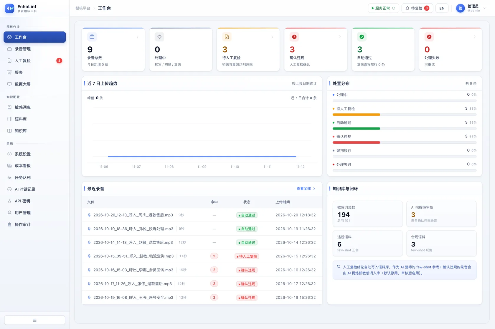
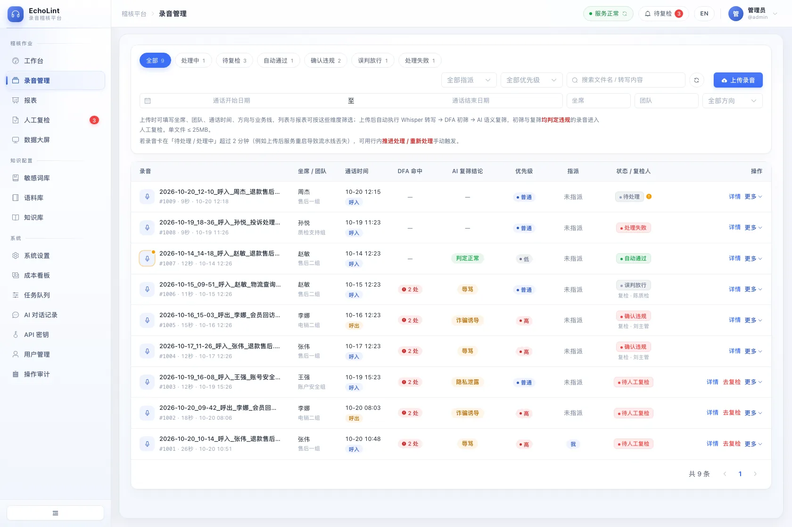
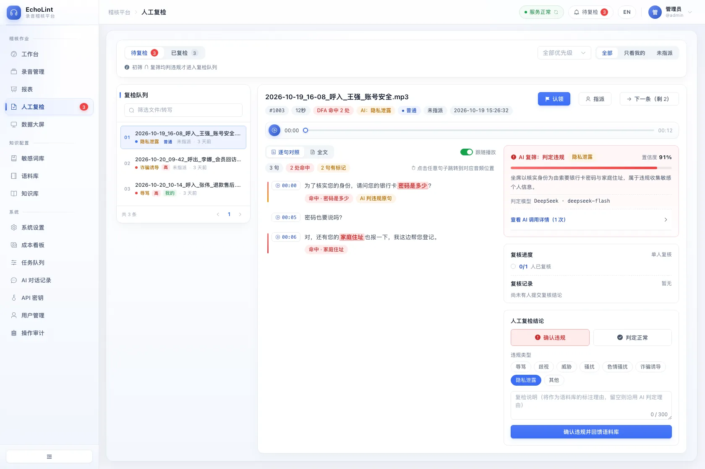
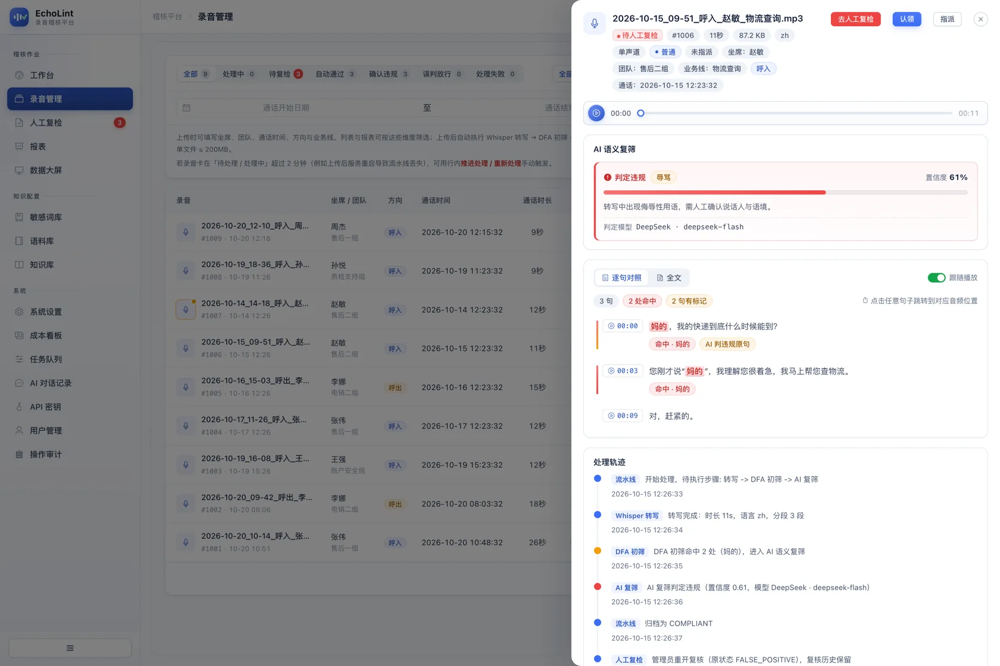
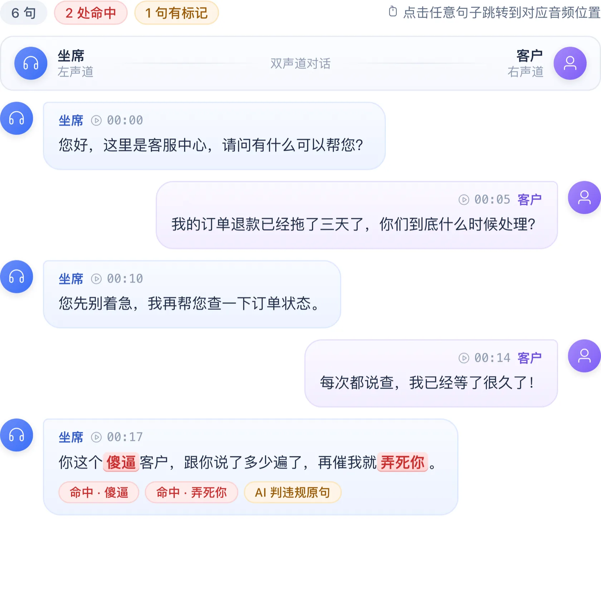
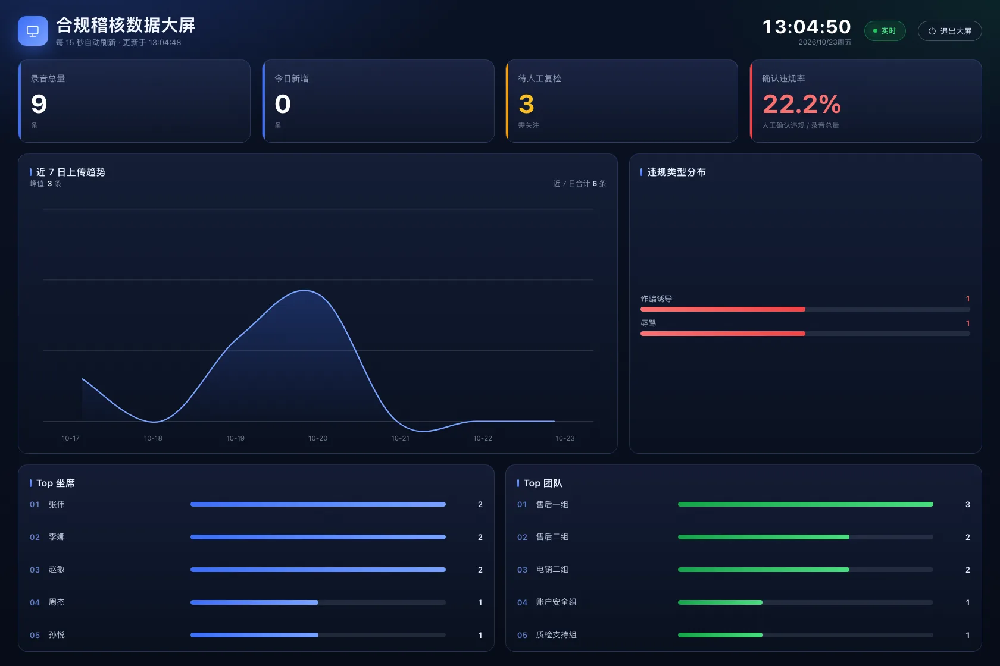

# EchoLint · 录音稽核平台

> 把每一通录音当作待检代码：先机械查词，再让 AI 读语境，最后交给人拍板。

EchoLint 是面向通话录音的合规稽核平台：上传录音后自动完成
**转写 → DFA 初筛 → AI 语义复筛 →（命中则）人工复检**，复检结论回馈语料库并挖掘新敏感词，形成自增长闭环。

- 语音转写支持 **阿里云百炼录音文件识别 / 本机 whisper.cpp** 双方案，系统设置页运行时切换；
- 数据库为 **PostgreSQL 17 + pgvector**（知识库 RAG）；
- 所有 API Key 在系统设置页录入，AES-GCM 加密存库，界面与接口只回掩码；
- 全站中 / 英双语，AI 调用全程留痕。

## 界面

| 工作台 | 录音管理 |
|---|---|
|  |  |

| 人工复检 | 录音详情（逐句对照 / 命中高亮 / 处理轨迹） |
|---|---|
|  |  |

| 双声道（双轨）对话 | 数据大屏 |
|---|---|
|  |  |

## 核心能力

- **四段流水线**：语音转写（百炼 / 本地 whisper.cpp 可切）→ DFA 初筛（Aho-Corasick + 字符跳变，`f u c k`、`f.u.c.k` 也能命中）→ AI 语义复筛（few-shot 语料 + 说话人标注）→ 人工复检；初筛与复筛均判违规才进复检队列。
- **AI 治理与成本**：供应商运行时切换（内置 DeepSeek / 阿里云百炼，可接任意 OpenAI 兼容网关）、A/B 分流、模型评测、配额、成本看板，以及提示词 / 原始回复 / token / 成本的完整调用留痕。
- **知识库 RAG**：PDF / DOCX / TXT / MD 导入 → 分块向量化（pgvector / HNSW）→ 复筛时语义召回注入；默认关闭，不可用时自动降级。
- **录音处理**：双声道自动分轨并分别转写、按时间对齐成对话（分离失败降级单声道）；上传上限 200MB；失败可重试。
- **工程能力**：持久任务队列（退避重试 / 死信）、Webhook 通知（HMAC）、开放 API（`X-API-Key`）、操作审计、多角色（ADMIN / REVIEWER / VIEWER）+ 用户级菜单绑定、单人 / 双人复核、数据大屏、响应式与键盘无障碍。

录音状态：

```
PENDING → TRANSCRIBING → DFA_CHECKING → AI_CHECKING → NEEDS_REVIEW → VIOLATION_CONFIRMED
                                                      │             └──→ FALSE_POSITIVE
                                                      └→ COMPLIANT
任一步异常 → FAILED（可在录音管理重试）
```

## 技术栈

| 层 | 技术 |
|---|---|
| 后端 | Spring Boot 3.5 / Java 17，Spring Data JPA，WebClient，Flyway，PostgreSQL 17 + pgvector |
| AI | 复筛 / 词挖掘：DeepSeek / 阿里云百炼（OpenAI 兼容协议）；语音转写：阿里云百炼 `qwen-audio-3.1-asr-flash-filetrans` 或本机 [whisper.cpp](https://github.com/ggml-org/whisper.cpp) |
| 前端 | Vue 3 + Vite 7 + Element Plus + vue-router + axios；零依赖轻量 i18n（中 / 英） |
| 部署 | docker compose（PostgreSQL/pgvector + 后端 + Nginx 前端）；生产编排见 [deploy/DEPLOY.md](deploy/DEPLOY.md) |

## 快速开始（Docker 一键）

```bash
cp .env.example .env      # 生产至少改 POSTGRES_PASSWORD / APP_ADMIN_PASSWORD / APP_SECRET_KEY
docker compose up -d --build

# 前端 http://localhost:8081   后端 http://localhost:8082/actuator/health
# 默认管理员 admin / admin12345（生产必须用 APP_ADMIN_PASSWORD 覆盖）
```

- 启动后在「系统设置」页完成：AI 供应商密钥、语音转写方案与密钥（加密落库、只回掩码）。
  `.env` 里的 API Key 只是首次启动的引导值，可留空。
- 本地 whisper.cpp（可选兜底）：`tools/whisper-server.sh --daemon`，然后在设置页切到「本地 whisper.cpp」。
- 演示数据：`python3 tools/seed_demo_data.py --with-audio`（含双声道样例，见 [tools/demo/README.md](tools/demo/README.md)）。

## 常用配置（完整清单见 [.env.example](.env.example)）

| 变量 | 默认 | 说明 |
|---|---|---|
| `POSTGRES_PASSWORD` | `audit123` | 数据库口令（postgres 与 backend 共用），生产必须覆盖 |
| `APP_SECRET_KEY` | dev fallback | 密钥加密主密钥，生产必须配置且不可变更 |
| `APP_ADMIN_USERNAME` / `APP_ADMIN_PASSWORD` | `admin` / `admin12345` | 引导管理员，生产必须覆盖 |
| `WHISPER_BASE_URL` / `WHISPER_MODEL` | `127.0.0.1:9900` / `whisper-1` | 本地 whisper.cpp 地址（容器内用 `host.docker.internal`） |
| `DASHSCOPE_ASR_*` | `https://dashscope.aliyuncs.com` / `qwen-audio-3.1-asr-flash-filetrans` / `zh` | 百炼录音识别 base-url / 模型 / 语言提示（base-url 是 API 根域名，非 compatible-mode；带 `/api/v1` 会自动归一化） |
| `ASR_TIMEOUT_SECONDS` | `600` | 单次转写总预算（本地 / 云端统一，30–1800） |
| `APP_RAG_ENABLED` | `false` | RAG 总开关（需先在设置页配置 embedding 供应商） |
| `APP_RAG_EMBEDDING_PROVIDER` / `_MODEL` / `_MODELS` | `aliyun` / `qwen3.7-text-embedding` / 3 个候选 | embedding 供应商、模型与候选列表；设置页可切换（DB 优先），换模型后需重建索引 |
| `APP_NOTIFY_ENABLED` / `APP_STEREO_ENABLED` / `APP_REVIEW_REQUIRED_APPROVALS` | `false` / `true` / `1` | 通知、双声道、落结论所需复核人数 |
| `APP_RETENTION_*` | 关闭 / 180、365、90 天 | 数据保留清理（AI 留痕 / 审计 / 流水线日志），uploads 不自动删除 |
| `SPRING_DATASOURCE_*` | `localhost:5432` / `audit` | 数据库连接（compose 内为 `postgres:5432`） |

集成适配器开关（多租户 / SSO / 流式 ASR / 说话人分离）默认全部关闭，见 [docs/integrations.md](docs/integrations.md)。

## 文档

| 文档 | 内容 |
|---|---|
| [docs/architecture.md](docs/architecture.md) | 系统架构、流水线、代码地图 |
| [docs/asr-and-settings-refactor.md](docs/asr-and-settings-refactor.md) | 语音转写双 provider 与系统设置页的设计 / 契约 |
| [docs/rag-integration.md](docs/rag-integration.md) · [docs/rag-contract.md](docs/rag-contract.md) | RAG 架构、配置与内部接口契约 |
| [docs/integrations.md](docs/integrations.md) | 多租户 / SSO / 流式 ASR / 说话人分离适配器 |
| [docs/deployment-records.md](docs/deployment-records.md) | 历次生产部署记录（历史，含 2026-10-22 前的 MySQL 时代） |
| [docs/production-readiness.md](docs/production-readiness.md) | 分批实现记录、验收清单与已知限制（历史） |
| [docs/postgres-migration.md](docs/postgres-migration.md) | MySQL → PostgreSQL 迁移与回滚手册（2026-10-22 已完成） |
| [frontend/src/i18n/README.md](frontend/src/i18n/README.md) | 中 / 英文案与新增 key 约定 |

API：启动后可访问 `http://localhost:8082/swagger-ui/index.html` 或 `/v3/api-docs`。

## 项目结构

```
echolint/
├── backend/          # Spring Boot（controller/service/asr/dfa/entity/…）
├── frontend/         # Vue 3 管理端（views/components/i18n/styles）
├── tools/            # 演示数据、whisper.cpp 启动脚本、迁移工具
├── docs/             # 架构、RAG、迁移、部署记录与截图
├── docker-compose.yml
└── .env.example
```

## 本地开发与测试

```bash
docker compose up -d postgres        # PostgreSQL 17 + pgvector（宿主 5433）

# 后端（本机 5432 没有 PG 时指向容器 5433）
cd backend
export SPRING_DATASOURCE_URL='jdbc:postgresql://localhost:5433/echolint'
mvn spring-boot:run

# 前端（/api、/uploads 代理到后端）
cd frontend
npm install
VITE_API_TARGET=http://localhost:8082 npm run dev

# 测试与格式
(cd backend && mvn -B test && mvn -B spotless:check)
(cd frontend && npm test && npm run build && npm run lint && npm run format:check && npm run i18n:audit)
```

CI（[.github/workflows/ci.yml](.github/workflows/ci.yml)）：后端 700+ 单测 + Spotless；前端 lint / format / build / 单测 / i18n 审计 / `npm audit`；两个镜像构建冒烟；compose 语法与 `application.yml` ↔ `.env` 变量一致性校验。依赖升级由 Dependabot 每周开 PR。

可观测性：`/actuator/health`、`/actuator/prometheus`（含 `echolint_pipeline_tasks`、`echolint_recordings_backlog`、`echolint_ai_invocations_today`、`echolint_ai_cost_micros_today` 业务指标）。

## 注意事项

- **API Key 只存数据库**：供应商 / 转写密钥在系统设置页录入，AES-GCM 加密存 `app_settings`，接口与界面只回掩码；`.env` 中的同类变量仅作为首次启动的引导值，之后以数据库为准。
- **转写方案可切换**：默认本地 whisper.cpp（需先启动服务）；设置页切到百炼后走云端（按量计费、数据不出境；临时上传接口限流 100 QPS，量大建议自有 OSS）。只保存配置不会切换生效服务；两边都不可用时录音进 `FAILED`，可在录音管理重试。
- **降级而非漏审**：AI 调用失败时，DFA 命中的录音转人工复检（`aiResultJson.degraded=true`）；ASR 可能听错（如「傻逼」→「少逼」），词典要补同音变体。
- **复核与安全**：`APP_REVIEW_REQUIRED_APPROVALS=2` 开启双人复核；上线前修改默认管理员密码与 `APP_SECRET_KEY`，后端只绑回环并置于 HTTPS 反代之后；开放 API 当前无限流 / 租户隔离，仅在可信网络内使用。
- **数据库口令轮换**：`POSTGRES_PASSWORD` 只在全新 `pg-data` 卷初始化时生效；已有卷需先执行 `ALTER USER audit PASSWORD '新口令';`，再更新 `.env` 并重启 backend。

## License

Proprietary / All rights reserved，详见 [LICENSE](LICENSE)。
