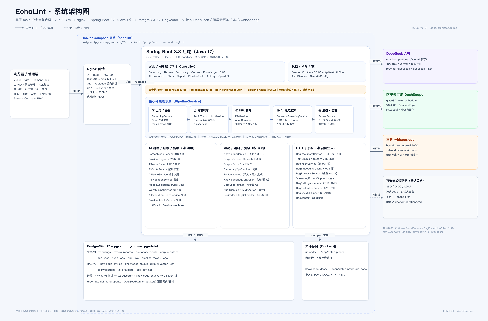
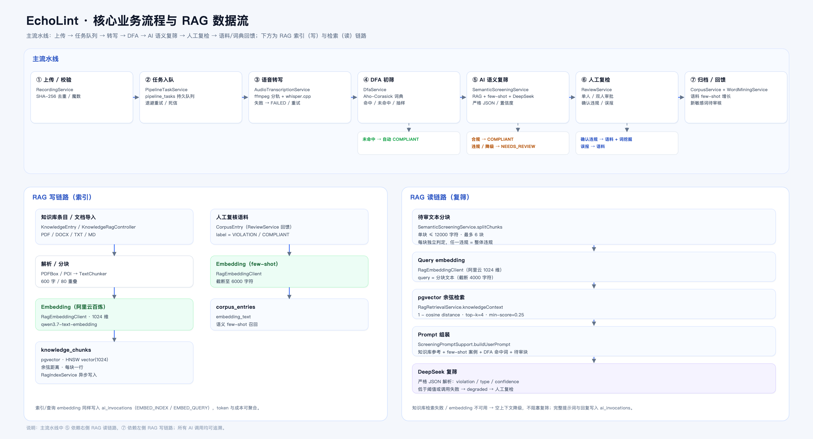

# EchoLint 系统架构

> 基于 `main` 分支当前代码整理（2026-10-21）。矢量源文件：[architecture.svg](architecture.svg)、[architecture-flow.svg](architecture-flow.svg)。

## 1. 系统架构图



## 2. 核心业务流程与 RAG 数据流



## 3. 分层说明

| 层 | 组成 | 说明 |
|---|---|---|
| 接入层 | 浏览器 / 管理端（Vue 3 SPA） | 15 个页面：工作台、录音管理、人工复检、敏感词库、语料库、知识库（含「索引明细」Tab，仅 ADMIN）、报表、成本、任务、AI 对话记录、审计、设置等；Session Cookie + 角色（ADMIN/REVIEWER/VIEWER） |
| 前端容器 | Nginx | 静态资源、SPA fallback、`/api` 与 `/uploads` 反向代理、gzip/长缓存；宿主端口 8081 |
| 后端 API | Spring Boot 3.3 / Java 17 | 18 个 Controller；同步 REST + 线程池异步流水线；Actuator/Prometheus/OpenAPI |
| 稽核流水线 | `PipelineService`、`PipelineTaskScheduler`、`AudioTranscriptionService`、`DfaService`、`SemanticScreeningService`、`ReviewService` | 上传 → 任务队列 → 转写 → DFA → AI 语义复筛 → 人工复检 → 语料/词典回馈 |
| AI 治理 | `ScreenModelService`、`ProviderRegistry`、`AiModelCaller`、`AiQuotaService`、`AiUsageService`、`AiInvocationService`、`ModelEvaluationService`、`WordMiningService` | 供应商运行时切换、AES-GCM 密钥、重试/超时、配额、成本快照、完整调用留痕 |
| RAG 子系统 | `RagDocumentService`、`TextChunker`、`RagIndexService`、`RagEmbeddingClient`、`RagRetrievalService`、`ScreeningPromptSupport`、`RagSettingsService`、`RagAdminService`、`RagEvaluationService`、`KnowledgeIndexService` | 文档导入、异步分块/向量化、pgvector 检索、提示词注入、索引重建、索引明细与对比评测 |
| 数据层 | PostgreSQL 17 + pgvector | 业务表 + `knowledge_chunks(vector 1024, HNSW)` + `ai_invocations`；Flyway V1/V2/V3，Hibernate `ddl-auto: update`；`DataSeedRunner` 预置词典/语料 |
| 文件存储 | Docker 卷 `uploads` / `knowledge-docs` | 录音原件、双声道分轨、导入的 PDF/DOCX/TXT/MD 原文 |
| 外部依赖 | DeepSeek（chat）、阿里云百炼 DashScope（embedding）、本机 whisper.cpp（ASR） | 全部走兼容 HTTP 接口；密钥不出后端；录音转写不出本机（whisper.cpp） |

## 4. 后端代码地图

### 4.1 接入与安全
- `controller/`：认证/用户/审计、录音/复核、词典/语料/知识库、RAG 设置、AI 对话、统计/报表、任务、开放 API。
- `config/SecurityConfig`：会话 Cookie + URL/方法级 RBAC；`/api/open/**` 由 `ApiKeyAuthFilter` 校验 `X-API-Key`。
- `service/AuditService`：所有敏感操作写 `audit_logs`，写入失败不影响主流程。

### 4.2 稽核流水线
- `PipelineTaskService` / `PipelineTaskScheduler` / `PipelineRecoveryService`：`pipeline_tasks` 持久队列、退避重试、死信、重启恢复。
- `AudioTranscriptionService` + `TranscriptionService`：ffmpeg 探测/分轨，本机 whisper.cpp 转写，逐句分段。
- `DfaService`：Aho-Corasick 词典匹配（字符跳变、大小写不敏感），词典变更后重建匹配器。
- `SemanticScreeningService` + `ScreeningPromptSupport`：全文分块、RAG 召回、few-shot、DeepSeek 调用、严格 JSON 解析、置信度阈值与降级。
- `ReviewService`：单人/双人复核、认领/指派/重开、语料回馈与词挖掘触发。

### 4.3 AI 治理
- `ScreenModelService`：当前复筛模型选择持久化到 `app_settings`，运行时切换。
- `ProviderRegistry` / `ProviderAdminService`：供应商清单、AES-GCM 密钥、价格快照。
- `AiQuotaService`：每日 token 配额与每分钟调用数。
- `AiUsageService` / `AiInvocationService`：成本聚合与完整请求/响应留痕（`ai_invocations`）。
- `ModelEvaluationService`：标注语料上的 accuracy/precision/recall 评测。

### 4.4 RAG
- 写链路：`KnowledgeRagController` / `RagDocumentService` → `TextChunker` → `RagEmbeddingClient`（阿里云 `qwen3.7-text-embedding`，1024 维）→ `knowledge_chunks`（pgvector HNSW）。
- 读链路：`RagRetrievalService` 对分块文本做 query embedding → 余弦 top-k → 注入 `ScreeningPromptSupport` 的用户提示词。
- 语料 few-shot：`CorpusEntry` 整段 embedding 写入 `corpus_entries.embedding_text`，按相似度取样。
- 运维：`RagSettingsService`（开关/检索参数持久化）、`RagAdminService`（索引统计/测试/重建）、`RagEvaluationService`（with/without RAG 对比评测）、`RagBackfillRunner`（启动回填）。
- 索引明细：`GET /api/knowledge/{id}/chunks`（仅 ADMIN，`KnowledgeIndexController` / `KnowledgeIndexService`）返回条目索引状态与分块分页明细，供知识库页「索引明细」Tab（仅 ADMIN，`views/KnowledgeIndex.vue` 作为页内面板组件）展示与失败排查；旧 URL `/knowledge-index` 重定向到 `/knowledge?tab=index`。
- 降级：embedding 不可用/检索失败 → 空上下文继续复筛，`aiResultJson.rag.status=degraded`，不阻塞主流程。

### 4.5 数据与迁移
- 迁移：`V1__baseline.sql`（基线标记）→ `V2__postgres_pgvector_rag.sql`（vector 扩展、`knowledge_chunks`、HNSW）→ `V3__rag_embedding_1024.sql`（索引调整为 1024 维）。
- 关键表：`recordings`、`review_records`、`dictionary_words`、`corpus_entries`、`knowledge_entries`、`knowledge_chunks`、`ai_invocations`、`ai_providers`、`app_settings`、`pipeline_tasks`、`audit_logs`、`app_user`、`api_keys`。
- 迁移手册：[postgres-migration.md](postgres-migration.md)；RAG 配置与 API：[rag-integration.md](rag-integration.md)。

## 5. 部署视图

```
浏览器 :8081
  └─ frontend（Nginx） :80
       ├─ /             Vue 3 静态资源
       └─ /api /uploads → backend:8080
backend（Spring Boot）
  ├─ PostgreSQL 17 + pgvector（postgres:5432，宿主 5433）
  ├─ DeepSeek API（chat completions）
  ├─ 阿里云百炼 DashScope（/embeddings，1024 维）
  └─ 本机 whisper.cpp（host.docker.internal:9900）
```

- Docker Compose 服务：`postgres` / `backend` / `frontend`；卷：`pg-data`、`uploads`、`knowledge-docs`。
- 后端内置线程池：`pipelineExecutor`（稽核）、`ragIndexExecutor`（索引/文档解析）、`notificationExecutor`（Webhook）。
- 可观测性：`/actuator/health`、`/actuator/prometheus`、`/v3/api-docs`、`/swagger-ui/index.html`。
