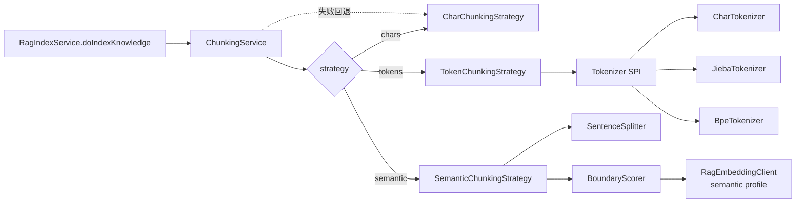

# RAG 分块策略升级设计：分词器与语义切块

> 状态：**草案（Proposed，待评审）** · 日期：2026-10-21
> 影响模块：`TextChunker`、`RagIndexService`、`RagProperties`、`RagEmbeddingClient`、`RagAdminService`、设置页、`ai_invocations`
> 关联文档：[rag-contract.md](rag-contract.md) · [rag-integration.md](rag-integration.md) · [知识库切片时序图](rag-chunking-sequence.svg)
>
> 阅读指引：评审看 §0、§4、§14、§15；实现看 §5–§13；排查现状看 §1 与附录 A。

## 0. 决策摘要

| 编号 | 决策 | 理由 |
|---|---|---|
| D1 | 保留 `TextChunker.split(text, chars, overlap)` 兼容入口，不修改其签名 | 现有单测、调用方、行为不变；避免把网络 I/O 塞进纯函数 |
| D2 | 新增 `ChunkingStrategy` SPI 与 `ChunkingService`；`TextChunker` 退化为字符策略门面 | 切块是策略/配置问题，需要 DI、回退与可观测性 |
| D3 | 默认策略仍为 `chars`，输出与当前完全一致 | 零回归上线；分词器/语义切块均为 opt-in |
| D4 | 分词器作为 `tokens` 策略的可插拔单元（char / jieba / HanLP / BPE） | “按词切”和“按模型 token 切”是两种不同需求，统一在 Tokenizer 抽象下 |
| D5 | 语义切块作为独立策略，使用**独立的 embedding profile**，默认关闭 | 不影响索引向量与 HNSW 维度；可单独计费、限流、降级 |
| D6 | 切换策略必须全量重建；**不自动重建**，由管理员显式触发 | 避免配置变更引发意外费用/限流；重建是可控动作 |
| D7 | 每条知识库条目记录 `chunker_signature`，并参与 `embedding_hash` | 防止旧策略的分块在“内容未变”时被跳过；可检测混合状态 |
| D8 | 索引 embedding 模型的切换不在本设计范围内，继续走 V3 式“清空 + 重建” | 不同模型的向量不可比较，HNSW 维度固定，不能热切 |

## 1. 背景与现状

### 1.1 当前链路

```
KnowledgeService.create/update
  └─ RagIndexService.enqueueKnowledge(entryId)        # RAG 关闭时 no-op
       └─ ragIndexExecutor（异步）
            └─ doIndexKnowledge
                 1. findById
                 2. sha256(title + "\n" + category + "\n" + content) 指纹
                 3. READY 且指纹未变且 chunk_count > 0 → 跳过
                 4. TextChunker.split(content, 600, 80)
                 5. 超过 MAX_CHUNKS_PER_ENTRY=400 → 截断
                 6. 每块拼 title + category + chunk 作为 embedding 输入
                 7. RagEmbeddingClient.embed（batch=8，1024 维）
                 8. deleteByEntryId + saveAll（全量替换）
                 9. READY + chunk_count + embedding_hash + indexed_at
```

对应代码：

- 切块算法：`backend/src/main/java/com/echolint/service/rag/TextChunker.java`
- 索引编排：`backend/src/main/java/com/echolint/service/rag/RagIndexService.java`（`doIndexKnowledge`）
- 配置：`backend/src/main/java/com/echolint/config/RagProperties.java`
- 表与索引：`backend/src/main/resources/db/migration/V2__postgres_pgvector_rag.sql`、`V3__rag_embedding_1024.sql`
- 检索：`backend/src/main/java/com/echolint/service/rag/RagRetrievalService.java`

### 1.2 当前分块算法

`TextChunker.split` 是**纯字符窗口**算法：

- 单块最大 `chars`（默认 600），相邻重叠 `overlap`（默认 80）；
- 在后半窗口从右往左找切点，优先级：换行 → 句末标点 `。！？!?；;…` → 空白 → 硬切；
- 每块独立 `strip()`，空块丢弃；
- 重叠按原始字符位置回退，最多 `chars/2`，保证前进。

它解决了“不要从句中硬切”的问题，但存在以下局限：

1. **字符数 ≠ 模型 token 数**：600 个中文字符可能超过或远小于 embedding 输入预算；无法按 token 控制。
2. **无标点长句/英文段落**会硬切或切得很碎（空格兜底取窗口后半段最靠左的空格，块可能接近 `chars/2`）。
3. **无语义**：标题、正文、列表项可能被切到不同块；语义连贯性完全靠重叠兜底。
4. **不可切换**：只有 `chars/overlap` 两个参数；无法按文档类型选择策略。
5. **静态方法难以承载配置与失败处理**：它是 `static`、无状态、无 Spring 依赖，适合纯算法，不适合 I/O。

### 1.3 为什么不能在 `TextChunker.split` 上直接加参数

| 方案 | 问题 |
|---|---|
| `split(text, tokenizer, semanticModel)` | 语义模型需要网络调用、超时、重试、配额、失败回退；纯函数不再纯 |
| 在 `TextChunker` 里注入 Spring Bean | 该类目前被单测直接静态调用；改造会波及测试与调用方 |
| 每个调用方自己拼 tokenizer | 配置发散，无法统一签名/重建/监控 |

结论：**切块算法保持纯函数，切块“策略选择与编排”上移**。

## 2. 目标与非目标

### 2.1 目标

- G1：支持按配置切换分块策略：`chars` / `tokens` / `semantic`，默认 `chars`。
- G2：支持分词器切换：字符、中文词级（jieba/HanLP）、模型 token（BPE/近似）。
- G3：支持语义切块，可独立选择边界模型/供应商，失败自动回退，不阻塞索引。
- G4：保持现有行为、接口、数据结构兼容；`chars` 模式输出不变。
- G5：可复现：每条索引记录切块签名；配置变化可检测、可重建。
- G6：可观测、可计费：语义边界调用与索引调用分开统计（`EMBED_CHUNK` / `EMBED_INDEX`）。

### 2.2 非目标

- N1：不做索引 embedding 模型的热切换；不改变 HNSW 维度。
- N2：不做“自动全量重建”；配置变更只提示，由管理员触发。
- N3：不引入按条目/按租户的细粒度策略（后续可选）。
- N4：不承诺语义切块一定优于字符切块；需用评测数据说话。
- N5：P1/P2 不改管理端 UI；运行时切换放到 P3。
- N6：不重写现有字符算法（包括空格兜底行为），避免回归。

## 3. 术语

| 术语 | 含义 |
|---|---|
| Tokenizer（分词器） | 把文本切成离散单元并给出字符偏移；单元可以是字符、词或 BPE token |
| ChunkingStrategy（切块策略） | 决定如何把 Tokenizer 的单元组合成最终 chunk |
| ChunkSpec | 一次切块的不可变参数快照（策略、大小、重叠、tokenizer、语义配置） |
| Chunker Signature | 对 ChunkSpec 的规范化字符串/哈希；用于判断“这条索引是不是当前策略产的” |
| Semantic Profile | 语义边界检测专用的 embedding 配置（provider/model/dim/batch/timeout） |
| BoundaryScorer | 给句子窗口打向量的接口；生产实现调用 embedding，单测用桩 |

## 4. 方案对比与决策

| 方案 | 描述 | 结论 |
|---|---|---|
| A. 扩展 `TextChunker.split` | 增加 tokenizer/model 参数，直接在里面调用 | **拒绝**：纯函数被污染、单测需 mock 网络、配置分散 |
| B. 策略模式 + 编排服务 | `ChunkingService` 选择 `ChunkingStrategy`，`TextChunker` 保留字符实现 | **采纳**（D2） |
| C. 引入 Spring AI / LangChain4j 分块器 | 使用框架的 TokenSplitter / SemanticSplitter | **暂缓**：当前已有 embedding 客户端与治理链路，引入框架收益有限、抽象成本高 |
| D. LLM 直接分段 | 让 chat 模型输出分段边界 | **暂缓**：成本/延迟高、不确定性大；先做 embedding 相似度方案 |
| E. 独立分块微服务 | 拆分独立服务处理文档切块 | **拒绝**：当前单体 + 异步线程池足够，运维复杂度不划算 |

## 5. 目标架构



### 5.1 包结构

新增 `com.echolint.service.rag.chunk`：

```
chunk/
  ChunkingStrategy.java          // SPI
  ChunkingService.java           // 配置解析、策略选择、回退、签名
  ChunkSpec.java                 // 不可变参数快照
  ChunkResult.java               // pieces + requested/effective signature + fallback 标记
  CharChunkingStrategy.java      // 现有算法迁入
  TokenChunkingStrategy.java
  SemanticChunkingStrategy.java
  Tokenizer.java                 // tokenize -> List<Span>
  Span.java                      // [start, end) 字符偏移
  CharTokenizer.java
  JiebaTokenizer.java
  BpeTokenizer.java              // P1 可选，支持 spans 则用，否则 count + 二分
  SentenceSplitter.java
  BoundaryScorer.java
  EmbeddingBoundaryScorer.java   // 生产实现，调用 RagEmbeddingClient
  ChunkerSignature.java          // 规范化签名
```

`TextChunker` 保留在 `service.rag`，内部委托 `CharChunkingStrategy`：

```java
@Deprecated
public static List<String> split(String text, int chunkChars, int overlap) {
    return CharChunkingStrategy.INSTANCE.chunk(text,
            ChunkSpec.chars(chunkChars, overlap));
}
```

### 5.2 核心接口

```java
public interface ChunkingStrategy {
    String id();                                      // chars-v1 / tokens-v1 / semantic-v1
    List<String> chunk(String text, ChunkSpec spec);
}

public interface Tokenizer {
    String id();                                      // char / jieba / hanlp / cl100k_base
    boolean supportsSpans();
    List<Span> spans(String text);                    // supportsSpans=true 时可用
    int count(String text);                           // 不依赖 span 的计数（BPE 用）
}

public interface BoundaryScorer {
    List<float[]> embed(List<String> windows);        // 顺序与入参一致
    String signature();                               // provider/model/dim 的稳定描述
}
```

`ChunkSpec` 建议：

```java
public record ChunkSpec(
        Strategy strategy,          // CHARS / TOKENS / SEMANTIC
        int maxChars,               // chars 模式：字符上限；tokens 模式：仅用于安全兜底
        int overlapChars,
        Tokenizer tokenizer,        // tokens 模式必填
        SemanticOptions semantic,   // semantic 模式必填
        Strategy fallback           // 失败回退，默认 CHARS
) {}
```

### 5.3 `ChunkingService` 职责

1. 从 `RagProperties` 读取并钳制配置，构造 `ChunkSpec` 快照；
2. 按 `strategy` 选择 `ChunkingStrategy`（未知值 → `chars` + WARN）；
3. 记录 `requestedSignature`；
4. 执行策略；捕获 `RuntimeException`：
   - 语义/分词失败且 `fallback != strategy` → 执行回退策略，记录 WARN、指标、`effectiveSignature`；
   - 回退也失败 → 抛给 `RagIndexService`，由现有逻辑标记 FAILED；
5. 返回 `ChunkResult`（不做 `MAX_CHUNKS_PER_ENTRY` 截断，截断仍在索引服务，保持单一职责）。

## 6. 分词器设计

### 6.1 三种“分词”语义

| 模式 | 单元 | 边界 | 依赖 | 适用 |
|---|---|---|---|---|
| `char` | Unicode 码点 | 字符窗口 + 句末/换行吸附 | 无 | 默认，兼容现有行为 |
| `word` | 中文词/英文单词/标点 | 词边界窗口；句末/换行优先 | jieba 或 HanLP | 中文 SOP、无标点长文 |
| `model-token` | BPE token | 按 token 数窗口；句末/空白吸附 | jtokkit / HF tokenizer | 控制 embedding 输入 token，跨语言 |

> 配置上后两种模式都落在 `strategy: tokens` + `tokens.tokenizer: jieba|hanlp|cl100k_base|qwen-approx`，由 Tokenizer 决定单元粒度。
>
> 说明：`TextChunker` 现有实现按 Java `char`（UTF-16 code unit）计数，可能切开 emoji/扩展汉字。新策略的 `char` tokenizer 以**码点**为单位，但 `chars` 策略**保持原算法不变**（N6），不修正历史行为。分词/token 策略不得切开代理对。

### 6.2 Tokenizer 抽象

- `Span` 使用 `[start, end)` 的 UTF-16 字符偏移，便于 `substring`；
- `JiebaTokenizer`：`JiebaSegmenter` 输出词与偏移；标点作为独立单元；纯空白不计数；
- `BpeTokenizer`：
  - 若库支持 offset 映射，直接产出 spans；
  - 否则 `supportsSpans=false`，用 `count(text)` + 对候选字符切点二分，找到“token 数 ≤ size”的最大前缀，再吸附句末/空白；
  - 不承诺切点严格落在 token 边界，但保证子串 token 数不超限。
- Qwen 官方 tokenizer 在 Java 侧没有轻量现成实现：P1 提供 `qwen-approx`（按码点 × 比例估算）并显式标注“近似”，或用 jieba 词级；精确 token 需要 HF tokenizer/ONNX 或 Python 服务（后续评估）。

### 6.3 窗口语义

- 窗口大小 `tokens.size`（默认 512），重叠 `tokens.overlap`（默认 64）；
- 候选窗口 = 最多 `size` 个 token；在窗口后半段找句末/换行/空白吸附，映射回字符偏移；
- 重叠按 token 数回退：`nextStartToken = endToken - overlap`，若不能前进则 `nextStartToken = endToken`；
- 输出仍为 `List<String>`，每块 `strip()`、空块丢弃；
- 若 tokenizer 计数异常（0、负数、超长）→ 回退 `chars`。

### 6.4 分词器切换的配置面

`tokenizer` 可选值：`char` / `jieba` / `hanlp` / `cl100k_base` / `qwen-approx`。  
P1 建议先实现 `char`、`jieba`、`qwen-approx`；`hanlp`、`cl100k_base` 按需求增量接入（依赖体积/许可需确认）。

## 7. 语义切块设计

### 7.1 算法

```text
1. normalize(text)（CRLF、控制字符）
2. sentences = splitSentences(text)
   - 句末标点：。！？!?；;… 与换行
   - Markdown 标题行（#）不单独成块，强制与后续内容合并
   - 单句 > semantic.max-chars → 该句降级为 token/char 切分
3. windows = pack(sentences, window-chars, window-sentences)
   - 每窗口约 2~3 句 / 不超过 window-chars
4. vectors = scorer.embed(windows)            # 批量，顺序一致
5. groups = []
   current = [windows[0]]
   for i in 1..n-1:
       sim = cosine(vectors[i-1], vectors[i])
       if sim < threshold OR currentChars + windows[i].chars > maxChars:
           groups.add(current); current = []
       current.add(windows[i])
   groups.add(current)
6. 合并 groups 为 chunk 文本：
   - 每组字符数 < min-chars 且与下一组合并后 ≤ max-chars → 合并
   - 块间可选保留最后 1 句作为重叠（sentence-overlap）
7. 输出 List<String>；超过 MAX_CHUNKS_PER_ENTRY 仍由索引服务截断
```

### 7.2 参数默认值（起点，需评测调优）

| 参数 | 默认 | 说明 |
|---|---|---|
| `threshold` | 0.72 | 相邻窗口余弦相似度低于此值断开 |
| `min-chars` | 240 | 块太小则尝试与下一组合并 |
| `max-chars` | 900 | 块硬上限；超过强制断开 |
| `window-chars` | 360 | 边界检测窗口大小 |
| `window-sentences` | 3 | 每窗口句数上限 |
| `sentence-overlap` | 1 | 相邻块保留的句数重叠 |
| `fallback` | `tokens` | 语义失败回退；也可配置 `chars` |

### 7.3 语义模型 profile

语义边界检测**不复用**索引 embedding 的全局配置隐式值，而是独立 profile：

```yaml
app.rag.chunk.semantic:
  provider-id: aliyun
  model: qwen3.7-text-embedding
  path: /embeddings
  dimensions: 1024
  timeout-seconds: 30
  batch-size: 8
```

- 维度只用于校验响应，不写入 HNSW，不影响索引维度；
- 可与索引 embedding 相同，也可不同（例如更便宜的模型）；
- `RagEmbeddingClient` 需要从“全局属性”改成接受 `EmbeddingProfile` 参数；现有调用传索引 profile，语义调用传语义 profile；
- 新增 `AiInvocationService.STAGE_EMBED_CHUNK`，成本看板可区分边界调用与索引调用。

### 7.4 失败与降级

- 超时、429/5xx、维度不匹配、返回数量不一致、空向量 → 捕获 `RuntimeException`；
- 回退到 `fallback` 策略；记录 WARN 与指标；**不让条目 FAILED**；
- 如果回退也失败 → 按现有逻辑 `FAILED + index_error`；
- 记录 `requestedSignature` 而非回退后的签名，避免语义模型短暂故障导致“每次写入都重建”；回退事实通过日志/指标暴露（是否加字段见开放问题）。

### 7.5 成本与延迟

- 边界检测 embedding 输入约为正文一遍 token；索引 embedding 再一遍 → **总 embedding token 约 2 倍**；
- 10 万字文档约 300–500 个窗口，batch=8 → 约 40–65 次边界调用；加索引调用，整体可能从秒级变为数十秒到数分钟；
- `ragIndexExecutor` 默认只有 2 个线程，语义切块会拉长单任务、阻塞其他索引任务；P2 需评估：
  - 单独 executor 或信号量限制语义切块并发；
  - 每条目时间预算/超时；
  - 只对超过阈值长度的文档启用语义切块。
- 现有 `AiQuotaService` 会统计这些调用；需要设置每日预算告警。

### 7.6 质量与评测

语义切块是启发式，不保证提升检索效果。上线前至少做：

1. 固定知识库与查询集（建议覆盖话术规范、违规示例、处罚标准）；
2. 分别用 `chars` / `tokens` / `semantic` 全量重建；
3. 用现有 `POST /api/settings/rag/evaluate` 对比 with/without RAG 的准确率、召回、延迟；
4. 额外记录“证据块是否被召回”（chunk hit rate）与索引耗时/token 成本；
5. 以“召回不下降、成本可接受”为通过标准，再考虑默认开启。

评测结果建议单独记录到 `docs/rag-chunking-eval.md`（后续）。

## 8. 配置参考

```yaml
app:
  rag:
    chunk:
      strategy: chars              # chars | tokens | semantic
      chars: 600                   # chars 策略 / token 策略的安全兜底
      overlap: 80
      tokens:
        tokenizer: jieba           # char | jieba | hanlp | cl100k_base | qwen-approx
        size: 512
        overlap: 64
      semantic:
        provider-id: aliyun
        model: qwen3.7-text-embedding
        path: /embeddings
        dimensions: 1024
        timeout-seconds: 30
        batch-size: 8
        threshold: 0.72
        min-chars: 240
        max-chars: 900
        window-chars: 360
        window-sentences: 3
        sentence-overlap: 1
        fallback: tokens           # chars | tokens
        max-windows-per-entry: 1000
```

环境变量按现有风格展开：`APP_RAG_CHUNK_STRATEGY`、`APP_RAG_CHUNK_TOKENS_TOKENIZER`、`APP_RAG_CHUNK_SEMANTIC_MODEL` 等。

钳制规则（建议）：

| 配置 | 取值 |
|---|---|
| `strategy` | 枚举，未知值 → `chars` + WARN |
| `chars` | 100–4000（沿用现有） |
| `overlap` | 0–`chars/2` |
| `tokens.size` | 64–8192 |
| `tokens.overlap` | 0–`size/2` |
| `semantic.threshold` | 0–1 |
| `semantic.min-chars` | 100–2000 |
| `semantic.max-chars` | 200–4000，且 ≥ `min-chars` |
| `semantic.window-chars` | 100–1000 |
| `semantic.window-sentences` | 1–10 |
| `semantic.max-windows-per-entry` | 100–5000 |
| `semantic.dimensions` | 1–16000 |

## 9. 索引链路改造

### 9.1 `RagIndexService.doIndexKnowledge` 新流程

```text
1. entry = findById
2. ChunkSpec spec = chunkingService.snapshotSpec()       # 任务开始时快照
3. signature = ChunkerSignature.of(spec)
4. fingerprint = sha256(title + "\n" + category + "\n" + content + "\n" + signature)
5. READY 且 fingerprint == embedding_hash 且 chunk_count > 0 → 跳过
6. INDEXING
7. result = chunkingService.chunk(content, spec)          # 失败回退在服务内处理
8. pieces = result.pieces()
9. pieces.size() > 400 → 截断（现有行为）
10. 空 → 清空 chunks，READY，chunk_count=0
11. embedTexts = title + "\n" + category + "\n" + piece
12. RagEmbeddingClient.embed(..., 索引 profile)           # 不变
13. 全量替换 chunks
14. READY；写 chunk_count、embedding_hash、chunker_signature = signature
```

要点：

- **快照**：任务开始时取 `ChunkSpec`，避免管理员中途改配置导致同一条目“切块用一个配置、签名写另一个配置”；
- **签名参与指纹**：即使内容没变，配置变化也会触发重建（前提是任务被入队，见 §10.3）；
- **截断位置不变**：`MAX_CHUNKS_PER_ENTRY` 仍在索引服务，保证语义策略不会突破成本上限；
- **embedding 输入不变**：仍是“标题 + 分类 + 块”，标题/分类不写进 `content`；
- **全量替换不变**：先删后插，失败时旧 chunks 保留（现有语义）。

### 9.2 回退时的签名

`ChunkResult` 返回：

- `requestedSignature`：本次配置期望的策略；
- `effectiveSignature`：实际产出策略（发生回退时不同）；
- `fallback`：是否发生回退。

`knowledge_entries.chunker_signature` 存 **requestedSignature**，用于配置变更检测；回退只记日志/指标，避免模型抖动导致反复重建（见开放问题 Q6）。

## 10. 数据模型、签名与重建

### 10.1 新增字段

`knowledge_entries` 增加：

| 列 | 类型 | 说明 |
|---|---|---|
| `chunker_signature` | varchar(160) null | 产出该索引时使用的切块签名；旧数据为 NULL |

建议用 Flyway `V4__rag_chunker_signature.sql` 显式加列（`ADD COLUMN IF NOT EXISTS`），与 V2 的增量列风格一致；Hibernate 实体同步加字段，`ddl-auto: update` 作为兜底。

```sql
ALTER TABLE knowledge_entries
    ADD COLUMN IF NOT EXISTS chunker_signature varchar(160);
```

`knowledge_chunks` **不新增列**：分块是整体替换的，条目级签名足以诊断；如后续需要审计每条 chunk，再评估。

### 10.2 签名格式

```text
v1|strategy=chars|chars=600|overlap=80
v1|strategy=tokens|tokenizer=jieba|size=512|overlap=64|fallback=chars
v1|strategy=semantic|profile=aliyun/qwen3.7-text-embedding/1024|thr=0.72|min=240|max=900|win=360|sent=3|overlap=1|fallback=tokens
```

- 规范化：字段顺序固定、数值格式化固定、空值省略；
- 长度 ≤160 直接存；超长则存 sha256（并在日志打印完整串）；
- 任何影响切块结果的参数都必须进入签名（含分词器 id、语义模型 id/维度、阈值、窗口大小）；
- Tokenizer 的 `id()` 必须带词典/模型版本（如 `jieba-1.0.2`），否则升级词典后签名不变，旧分块会被误判为最新；语义模型若有版本别名，尽量记录具体版本，无法获取时记录配置名并接受漂移风险。

### 10.3 陈旧检测与重建

- 当前签名放在 `chunk.signature`；`index` 增加 `chunkerStaleCount`：`READY` 且 `chunker_signature` 为空或不等于当前签名的条目数。
- 查询用派生方法/`@Query`：`index_status='READY' and (chunker_signature is null or chunker_signature <> :sig)`。
- 设置页显示提示：“N 条索引使用旧分块策略，建议重建”。
- **不自动重建**：启动时只 WARN，避免升级即触发大量 embedding 费用；由管理员点击“重建知识库索引”（现有 `/api/settings/rag/reindex`，scope=knowledge）。
- 重建期间旧 chunks 仍可被检索（现有行为）；需要严格一致时可在低峰执行。

### 10.4 迁移与回滚

- 旧数据 `chunker_signature = NULL`，被视为陈旧；不影响检索；
- 回滚：把 `strategy` 改回 `chars`，重建即可；新旧 chunk 混存期间检索仍可用（索引向量模型未变），只是分块边界不同；
- 不涉及 HNSW 索引变更；不需要清空 `knowledge_chunks`；
- 若未来切换索引 embedding 模型，仍按 V3 流程单独处理，不与本设计混用。

## 11. API 与界面

### 11.1 P1/P2：只读展示

`GET /api/settings/rag` 增加（additive，不破坏现有契约）：

```json
{
  "chunk": {
    "strategy": "chars",
    "tokenizer": null,
    "chars": 600,
    "overlap": 80,
    "tokens": { "size": 512, "overlap": 64 },
    "signature": "v1|strategy=chars|chars=600|overlap=80",
    "maxChunksPerEntry": 400
  },
  "index": {
    "chunkerStaleCount": 0
  }
}
```

设置页在 RAG 区域增加只读卡片：当前策略、参数、签名、陈旧条数与“重建”入口。

P1/P2 的“切换”是配置切换：修改 `application.yml` / 环境变量后重启（`RagProperties` 在启动时绑定），再触发全量重建；P3 才提供运行时接口。

### 11.2 P3：运行时切换（可选）

新增 `PUT /api/settings/rag/chunk`：

```json
{
  "strategy": "tokens",
  "tokenizer": "jieba",
  "chars": 600,
  "overlap": 80,
  "tokens": { "size": 512, "overlap": 64 },
  "semantic": { "threshold": 0.72, "minChars": 240, "maxChars": 900 }
}
```

- 校验/钳制后写入 `app_settings`（`RagSettingsService` 新 key）；
- 语义模型 provider/model/dimensions 仍从 yml 读取（涉及密钥与维度，不放进 UI 热切换）；
- 返回 `index.chunkerStaleCount` 与提示；**不自动重建**；
- 写审计（新增 `RAG_CHUNK_SETTINGS_UPDATE` 或复用现有 action，需确认）；
- UI 必须展示费用/耗时警告，并在切换后引导重建。

## 12. 可观测性

- 日志：`RAG 切块 entryId=... strategy=... tokenizer=... pieces=... fallback=... durationMs=...`
- 指标（Micrometer）：
  - `rag_chunk_duration_seconds{strategy}`
  - `rag_chunk_pieces{strategy}`
  - `rag_chunk_fallback_total{from,to}`
  - `rag_embed_chunk_total` / token 统计
- `ai_invocations` 新增 stage `EMBED_CHUNK`；成本看板按 stage 聚合。
- `GET /api/settings/rag` 展示配置、签名、陈旧条数、最近重建时间（已有）。

## 13. 测试与评测

### 13.1 单元测试

- `CharChunkingStrategyTest`：与现有 `TextChunkerTest` 等价；`TextChunker.split` 门面输出与迁移前逐字节一致。
- `TokenChunkingStrategyTest`：CJK、英文、混合、emoji/代理对、无标点长文、标题；块大小不超限、重叠正确、终止性。
- `JiebaTokenizerTest` / `BpeTokenizerTest`：span 不重叠、不切代理对、空文本、标点、字典版本固定。
- `SemanticChunkingStrategyTest`：用桩 `BoundaryScorer` 构造相似度序列，断言断点；min/max/标题/超长句；embedding 失败回退。
- `ChunkerSignatureTest`：顺序稳定、参数变化签名变化、超长哈希。
- `ChunkingServiceTest`：未知策略回退、回退失败抛错、快照不变。
- `RagProperties` 钳制测试。

### 13.2 集成测试

- `RagIndexServiceTest` 注入 mock `ChunkingService`：签名写入、指纹跳过、空内容、失败标记、全量替换顺序。
- `RagAdminServiceTest`：陈旧计数、视图 additive 字段。
- 可选：MockMvc 校验 `GET /api/settings/rag` 新增字段不破坏前端。

### 13.3 回归与性能

- 默认 `chars` 模式：同一批 fixture 的 chunks 与改造前完全一致。
- 100k 字符文档：记录 `chars` / `tokens` / `semantic` 的耗时、峰值内存、embedding token 估算。
- 确保 `MAX_CHUNKS_PER_ENTRY=400`、正文 100k 上限仍生效。

### 13.4 质量评测

见 §7.6；至少跑一轮 with/without RAG 对比，并记录到独立文档。

## 14. 实施计划

| 阶段 | 内容 | 主要文件 | 验收 |
|---|---|---|---|
| P0（本文） | 设计冻结、评审决策 | `docs/rag-chunking-strategy.md` | 评审通过，开放问题有结论 |
| P1 | 策略 SPI + `ChunkingService` + `chars`/`tokens` + 签名字段 + 配置钳制 + 单测 | `service/rag/chunk/*`、`TextChunker`、`RagProperties`、`RagIndexService`、`KnowledgeEntry`、`V4` | 默认输出不变；现有测试全绿；token 模式可用；无网络调用 |
| P2 | 语义切块 + 独立 profile + `EMBED_CHUNK` + 回退 + 评测 | `SemanticChunkingStrategy`、`BoundaryScorer`、`RagEmbeddingClient`、`AiInvocationService`、配置 | 默认关闭；失败回退不 FAILED；评测报告；成本可控 |
| P3 | 运行时切换 API + 设置页 + 陈旧提示 + 审计 | `RagSettingsService`、`RagSettingsController`、`RagAdminService`、`Settings.vue` | 切换后 `chunkerStaleCount` 正确；重建可触发；审计留痕；可回滚 |

工作量粗估：P1 1–2 人日，P2 3–5 人日（不含评测调参），P3 2–3 人日。实际以评审结论为准。

## 15. 风险与开放问题

### 15.1 风险

| 风险 | 影响 | 缓解 |
|---|---|---|
| 分词器依赖体积/许可 | 镜像变大、合规审查 | 先接 jieba；HanLP/BPE 按需；记录 LICENSE |
| token 计数不精确（Qwen） | 块大小超预算或偏小 | 明确 `qwen-approx` 为近似；优先精确 tokenizer；保留 `chars` 兜底 |
| 语义模型成本/限流 | 索引变慢、费用上升 | 默认关闭；独立 profile；预算告警；按文档长度启用 |
| 语义切块质量不稳定 | 召回下降 | 用评测集验证；可回退 `chars`；不自动开启 |
| `ragIndexExecutor` 被长任务占满 | 其他条目排队 | 语义并发信号量/独立 executor/超时预算（P2 决策） |
| 新旧签名混存 | 评测/排查困难 | `chunker_signature` + 陈旧提示；低峰重建 |
| 配置变更未重建 | 旧分块继续被检索 | 设置页 Banner；重建接口；日志 WARN |
| 管理员热切配置与在跑任务竞争 | 同条目签名不一致 | 任务开始时快照 `ChunkSpec`；按任务记录签名 |
| 语义模型供应商数据出境 | 合规风险 | 复用现有供应商治理；可选本地模型；文档披露 |

### 15.2 开放问题（评审需拍板）

- Q1：P1 默认分词器用 `jieba` 还是仅 `char`/`qwen-approx`？是否接受新增依赖？
- Q2：是否需要 `hanlp`、`cl100k_base`，还是先只做 `jieba`？
- Q3：语义边界模型是复用索引 embedding 模型，还是允许独立 provider/model？成本由谁承担？
- Q4：是否允许运行时切换 semantic model（涉及 provider/密钥/维度）？还是只允许 yml 切换 + 重建？
- Q5：配置变更后是否自动重建？本文建议“不自动”，需产品确认。
- Q6：回退到 token/char 时，是否需要在 UI 显示“降级索引”？是否加 `chunker_fallback` 字段？
- Q7：是否需要 per-entry 策略（例如长文档才用 semantic）？
- Q8：语义切块的验收指标与基线（召回下降多少算不可接受）？
- Q9：`MAX_CHUNKS_PER_ENTRY=400` 是否改为可配置？语义策略可能更容易触碰上限。
- Q10：P3 的运行时切换范围：是否只开放 strategy/tokenizer/阈值，模型仍走 yml？

## 附录 A：现有代码定位

| 位置 | 作用 |
|---|---|
| `backend/src/main/java/com/echolint/service/rag/TextChunker.java` | 字符窗口切块、边界吸附、重叠 |
| `backend/src/main/java/com/echolint/service/rag/RagIndexService.java` | 指纹跳过、切块、embedding、全量替换、状态机 |
| `backend/src/main/java/com/echolint/config/RagProperties.java` | `app.rag.*` 配置与钳制 |
| `backend/src/main/java/com/echolint/service/rag/RagEmbeddingClient.java` | embedding 调用、批量、重试、配额、留痕 |
| `backend/src/main/java/com/echolint/service/rag/RagSettingsService.java` | 运行时设置快照（`app_settings`） |
| `backend/src/main/java/com/echolint/service/rag/RagAdminService.java` | 设置视图、重建、索引统计 |
| `backend/src/main/java/com/echolint/service/rag/RagEvaluationService.java` | with/without RAG 评测 |
| `backend/src/main/java/com/echolint/entity/KnowledgeEntry.java` | 条目字段（`embedding_hash`、`chunk_count`、状态） |
| `backend/src/main/java/com/echolint/entity/KnowledgeChunk.java` | 分块字段 |
| `backend/src/main/resources/db/migration/V2__postgres_pgvector_rag.sql` | `knowledge_chunks` 建表 + 增量列 |
| `backend/src/main/resources/db/migration/V3__rag_embedding_1024.sql` | HNSW 维度调整先例 |
| `frontend/src/views/Settings.vue` | RAG 设置区 |
| `backend/src/test/java/com/echolint/service/rag/TextChunkerTest.java` | 现有切块行为基线 |

## 附录 B：与现有接口的兼容性

- `POST/PUT /api/knowledge`、`POST /api/knowledge/documents` 行为不变；
- `GET /api/settings/rag` 只增字段，前端旧代码可忽略；
- `POST /api/settings/rag/reindex` 复用，无需新接口即可触发重建；
- `knowledge_chunks` 表结构不变；检索 SQL 不变；
- `ai_invocations.stage` 新增枚举值，不影响现有聚合（按 stage 分组）。
